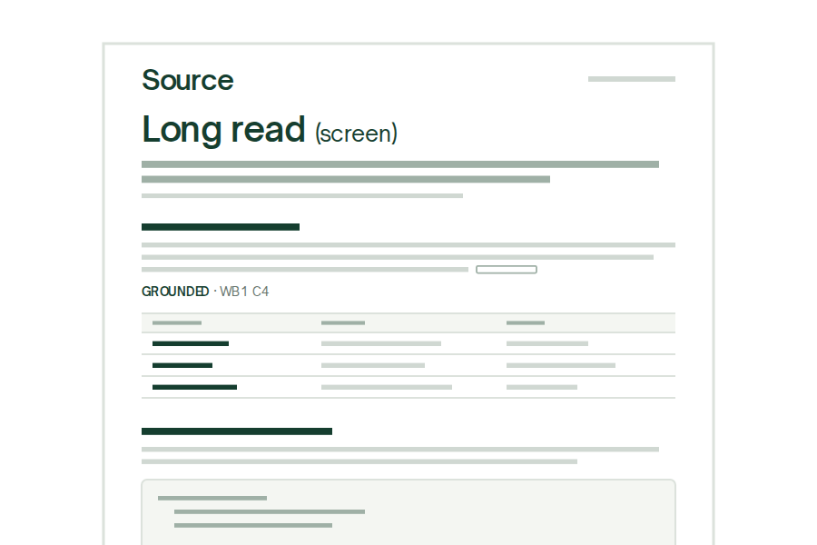

# How to use the document template (guide)

> One stylesheet and a small builder turn a Markdown file into a Source document: A4 sheets to print or send, or one long page to read on screen.

> For documentation, READMEs, one-pagers and write-ups. Process maps use their own system.

## Pick the shape of the document

Every document shares the same type, colours and parts. Only the page changes: a fixed A4 sheet, or a wider column with no set height. [CSS §2]

:::examples
+++ 01 One-pager
### A4 sheets
```svg
<svg viewBox="0 0 300 200" xmlns="http://www.w3.org/2000/svg" role="img" aria-label="Two A4 sheets of a one-pager document">
<g font-family="Source,Arial,sans-serif">
<rect x="22" y="16" width="120" height="170" fill="#fff" stroke="#dce2dc"/>
<text x="31" y="30" font-size="9" font-weight="600" fill="#153e2f" letter-spacing="-.3">Source</text>
<rect x="112" y="25.5" width="21" height="2" fill="#d0d8d2"/>
<text x="31" y="45" font-size="10" font-weight="600" fill="#153e2f" letter-spacing="-.35">Document title</text>
<rect x="31" y="51" width="98" height="2.4" fill="#9fb0a6"/><rect x="31" y="56" width="74" height="2.4" fill="#9fb0a6"/>
<rect x="31" y="61.5" width="62" height="1.6" fill="#d0d8d2"/>
<g fill="#f4f6f2" stroke="#dce2dc" stroke-width=".8"><rect x="31" y="68" width="31" height="20" rx="1.5"/><rect x="66.5" y="68" width="31" height="20" rx="1.5"/><rect x="102" y="68" width="31" height="20" rx="1.5"/></g>
<g fill="#e9713b"><rect x="31" y="91.5" width="11" height="1.4"/><rect x="66.5" y="91.5" width="13" height="1.4"/><rect x="102" y="91.5" width="10" height="1.4"/></g>
<g fill="#153e2f"><rect x="31" y="95" width="21" height="2"/><rect x="66.5" y="95" width="19" height="2"/><rect x="102" y="95" width="23" height="2"/></g>
<g fill="#d0d8d2"><rect x="31" y="99.5" width="29" height="1.4"/><rect x="66.5" y="99.5" width="27" height="1.4"/><rect x="102" y="99.5" width="28" height="1.4"/></g>
<line x1="31" y1="108.5" x2="133" y2="108.5" stroke="#dce2dc" stroke-width=".8"/>
<rect x="31" y="114" width="34" height="2" fill="#153e2f"/><rect x="85" y="114" width="30" height="2" fill="#153e2f"/>
<g fill="#d0d8d2"><rect x="31" y="119" width="47" height="1.5"/><rect x="31" y="122.5" width="44" height="1.5"/><rect x="31" y="126" width="46" height="1.5"/><rect x="31" y="131" width="45" height="1.5"/><rect x="31" y="134.5" width="38" height="1.5"/>
<rect x="91" y="119" width="42" height="1.5"/><rect x="91" y="122.5" width="35" height="1.5"/><rect x="91" y="127.5" width="41" height="1.5"/><rect x="91" y="131" width="30" height="1.5"/><rect x="91" y="136" width="40" height="1.5"/></g>
<g fill="#e9713b"><rect x="85" y="119" width="3.5" height="1.5"/><rect x="85" y="127.5" width="3.5" height="1.5"/><rect x="85" y="136" width="3.5" height="1.5"/></g>
<rect x="31" y="145" width="64" height="21" fill="#f4f6f2"/><rect x="31" y="145" width="1" height="21" fill="#153e2f"/>
<rect x="36" y="150" width="17" height="1.8" fill="#153e2f"/><rect x="36" y="155" width="52" height="1.4" fill="#d0d8d2"/><rect x="36" y="158.5" width="44" height="1.4" fill="#d0d8d2"/>
<line x1="31" y1="176" x2="133" y2="176" stroke="#dce2dc" stroke-width=".8"/>
<rect x="31" y="179.5" width="30" height="1.3" fill="#d0d8d2"/><text x="133" y="181.6" font-size="3.6" fill="#65736b" text-anchor="end">1 / 2</text>
<rect x="158" y="16" width="120" height="170" fill="#fff" stroke="#dce2dc"/>
<rect x="167" y="27" width="40" height="2.2" fill="#153e2f"/>
<g fill="#d0d8d2"><rect x="167" y="33" width="100" height="1.5"/><rect x="167" y="36.5" width="92" height="1.5"/></g>
<rect x="167" y="43" width="102" height="5.5" fill="#f4f6f2"/>
<g stroke="#dce2dc" stroke-width=".7"><line x1="167" y1="43" x2="269" y2="43"/><line x1="167" y1="48.5" x2="269" y2="48.5"/><line x1="167" y1="55" x2="269" y2="55"/><line x1="167" y1="61.5" x2="269" y2="61.5"/><line x1="167" y1="68" x2="269" y2="68"/></g>
<g fill="#9fb0a6"><rect x="170" y="45.2" width="14" height="1.2"/><rect x="205" y="45.2" width="12" height="1.2"/><rect x="240" y="45.2" width="10" height="1.2"/></g>
<g fill="#153e2f"><rect x="170" y="51.2" width="20" height="1.5"/><rect x="170" y="57.7" width="16" height="1.5"/><rect x="170" y="64.2" width="22" height="1.5"/></g>
<g fill="#d0d8d2"><rect x="205" y="51.2" width="26" height="1.5"/><rect x="240" y="51.2" width="18" height="1.5"/><rect x="205" y="57.7" width="22" height="1.5"/><rect x="240" y="57.7" width="24" height="1.5"/><rect x="205" y="64.2" width="28" height="1.5"/><rect x="240" y="64.2" width="15" height="1.5"/></g>
<rect x="167" y="77" width="34" height="2.2" fill="#153e2f"/>
<rect x="167" y="83" width="102" height="27" rx="1.5" fill="#f4f6f2" stroke="#dce2dc" stroke-width=".7"/>
<g fill="#9fb0a6"><rect x="172" y="88" width="30" height="1.4"/><rect x="176" y="92.5" width="52" height="1.4"/><rect x="176" y="97" width="44" height="1.4"/><rect x="172" y="101.5" width="12" height="1.4"/></g>
<rect x="167" y="117" width="96" height="1.5" fill="#d0d8d2"/><rect x="167" y="120.5" width="80" height="1.5" fill="#d0d8d2"/>
<rect x="167" y="125.5" width="46" height="1.3" fill="#9fb0a6"/>
<line x1="167" y1="135" x2="269" y2="135" stroke="#dce2dc" stroke-width=".8"/>
<rect x="167" y="140" width="19" height="2" fill="#153e2f"/>
<g fill="#153e2f"><rect x="167" y="146" width="9" height="1.4"/><rect x="167" y="150" width="11" height="1.4"/><rect x="167" y="154" width="8" height="1.4"/></g>
<g fill="#d0d8d2"><rect x="183" y="146" width="58" height="1.4"/><rect x="183" y="150" width="66" height="1.4"/><rect x="183" y="154" width="50" height="1.4"/></g>
<line x1="167" y1="176" x2="269" y2="176" stroke="#dce2dc" stroke-width=".8"/>
<rect x="167" y="179.5" width="30" height="1.3" fill="#d0d8d2"/><text x="269" y="181.6" font-size="3.6" fill="#65736b" text-anchor="end">2 / 2</text>
</g></svg>
```
Short documents to print, send as a PDF or read as a page.
A page-break line starts the next sheet.

+++ 02 Long read
### Screen mode

Documentation and write-ups that run past two pages.
Prints onto numbered A4 pages.

+++ 03 Build
### From Markdown
```markdown
# Title (draft)
> One-line lead.

## Section
A claim [WB1 C4]

1. **Do this.**
```
Write plain Markdown, then build one self-contained HTML file.
Fonts, styles and the wordmark are inlined.
:::

### What every document can use

:::columns
- Title, lead and support line
- Examples grid with art panels
- Two-column sections
- Numbered steps
- Tables and code blocks
- Next-step callout
- Citations and provenance lines
- Sources block and footer
:::

---

:::columns
## What you need

**A Markdown file.** Write it in any editor. The subset is short and is listed in the README. [DOC §Markdown subset]

**A sources file, if you cite.** A JSON file that names each source ID once. The builder collects every cited ID into the Sources block at the end. [BLD §Usage]

**Python 3 and a browser.** The builder uses only the standard library. The browser shows the page and its print preview.
+++
## How it works

1. **Write.** Start from this file or a blank one, with front matter for the title, label, date and footer.
2. **Build.** Run the builder with `--a4` for sheets or `--screen` for one long page.
3. **Check.** Open the result, then its print preview. Each A4 sheet should end inside its page.
4. **Share.** Send the HTML file, or print it to PDF.
:::

:::callout Next step
Copy `example.md`, replace the copy with your own and build it.

Keep each A4 sheet to one printed page by moving the page-break line.
:::

:::aside
### Where the files are
`doc.css`, `template.html`, `build_doc.py` and `fonts/` sit together in this folder.
:::

<!-- page -->

## Cite every claim

Put the citation straight after the claim, in square brackets: the source ID, a space, then the locator. The total for the period sits in one cell of the sample workbook [WB1 H9]. Several sources share one bracket, separated by semicolons [WB1 C4; WB1 D4].

Grounded · WB1 H9; WB1 C4–D4

A reading of the evidence, rather than a fact stated in it, gets an inferred line. A fact that no source holds gets a gap line, so the reader knows what is still open.

Inferred · from the column totals in WB1 col H

Gap · no owner is named in WB1; to confirm with the sheet's author

## The parts in Markdown

| Part | Markdown | Renders as |
|---|---|---|
| Title | `# Title (qualifier)` | 32px title with a lighter qualifier |
| Lead and support | `> One line`, then a second `>` block | 14px lead, then an 11px muted line |
| Steps | `1. **Do this.** Then…` | Orange numerals in their own column |
| Callout | `:::callout Next step` | Soft panel with an ink edge |
| Citation | `[WB1 H9]` | Visible marker, linked to Sources |

## Build it

1. **Build both modes.** From this folder, run:
   ```sh
   python3 build_doc.py example.md example-a4.html --a4 --sources example-sources.json
   python3 build_doc.py example.md example-screen.html --screen --sources example-sources.json
   ```
2. **Check it before you send it.** Build once more with `--strict`. Nothing is written while:
   - a cited ID has no name in the sources file
   - a bracket looks like a citation but is left as text

## Keep it calm

- Orange points the way: eyebrows, step numerals and the word Gap. Nothing else.
- One idea per paragraph, and let paragraphs breathe.
- Cite as you write. A claim without a source is a gap, so say so.
